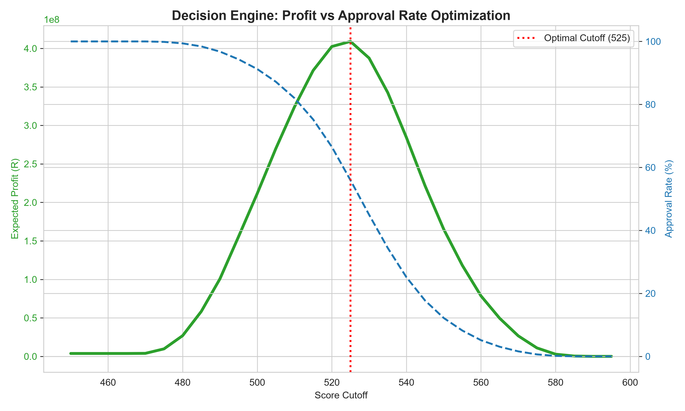
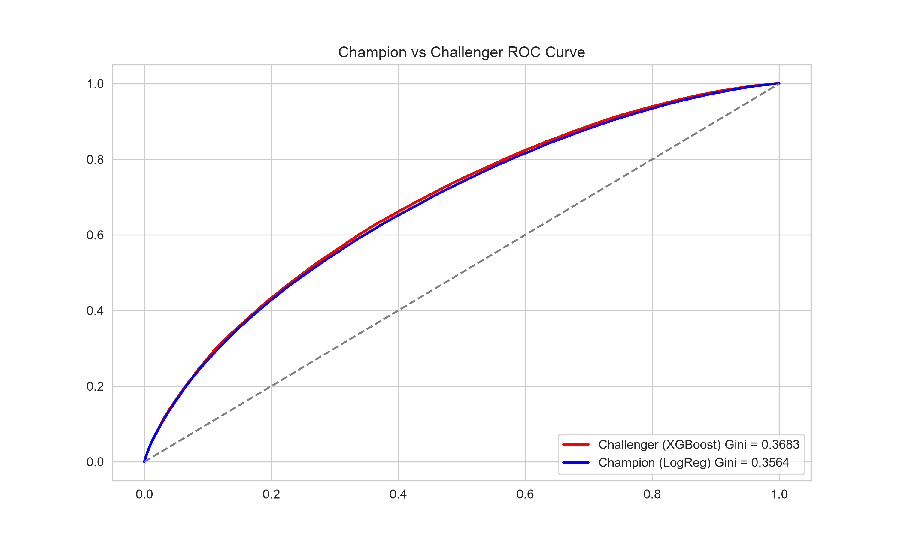
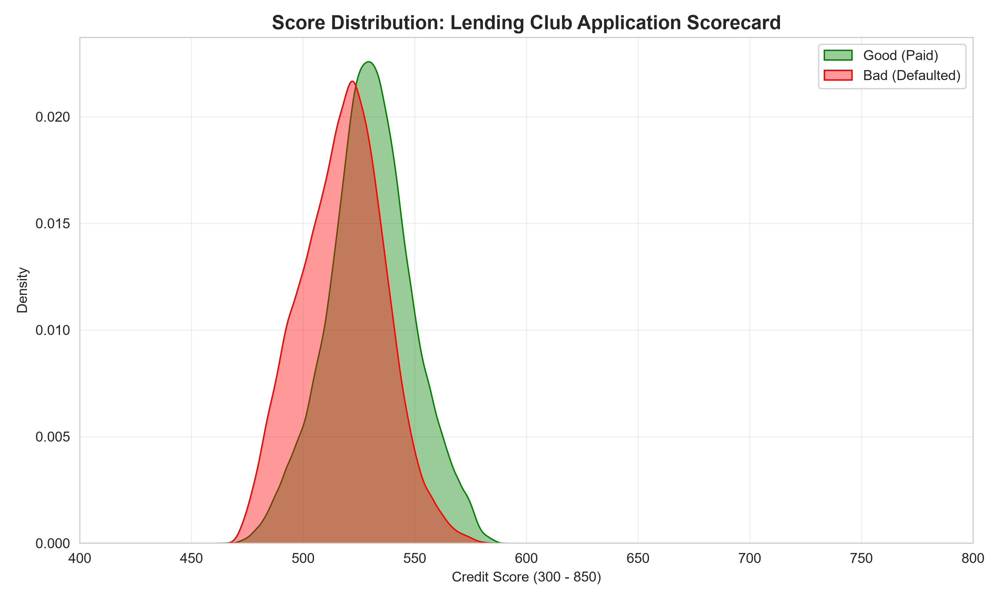

# Lending-Club-Application-Scorecard
An end-to-end Application Credit Scorecard and Profit-Optimization Decision Engine built on 1.3M Lending Club loans. Features WoE/IV, Logistic Regression (Champion) vs XGBoost (Challenger), PDO Scaling, Model Validation (Brier, PSI), and Business Cost-Matrix Cutoff Optimization.

# Lending Club Application Scorecard & Decision Engine

An end-to-end Application Credit Scorecard and Profit-Optimization Decision Engine built on 1.3 million unsecured Lending Club loans. This project demonstrates the full classical credit scoring lifecycle: Data Auditing, Weight of Evidence (WoE) transformation, Logistic Regression, PDO Scaling, Model Validation, and Business Cost-Matrix Cutoff Optimization.

## Overview
Unlike an IFRS 9 regulatory engine, this is a **decision-making tool**. It is designed to answer the question: *"Should we approve this loan application to maximize profit while managing default risk?"*

The model uses bureau-proxy variables (FICO, DTI, Income, etc.) to assign a credit score ranging from 300 to 850. A Profit Optimization Engine then sweeps through all possible score cutoffs to find the point that maximizes expected profit for the lender.

## Model Performance & Validation
The Logistic Regression Champion model was built using strictly non-collinear features and validated for discrimination, stability, and calibration.

> **Model Validation Metrics (Out-of-Sample Test Set)**
> 
> *   **AUC:** **0.6782** | **Gini:** **0.3564** (Industry standard for unsecured lending)
> *   **KS Statistic:** **0.2536**
> *   **PSI (Train vs Test):** **0.0000** (Highly stable)
> *   **Brier Score:** **0.1489** (Strong calibration)
> *   **Brier Skill Score:** **+0.0683** (Better than baseline)
> *   **Portfolio Calibration:** Mean Predicted PD (**19.97%**) vs. Actual Default Rate (**19.96%**)

📄 **[Click here to read the full Model Validation Report](validation_report_v1.md)**

## The Decision Engine (Profit Optimization)
A bank doesn't care about Gini; it cares about profit. We built a Business Cost Matrix assuming a Good Loan yields R5,000 in interest profit, and a Bad Loan costs R20,000 in lost principal.

*Figure 1: Profit vs Approval Rate Optimization Curve.*

**The Business Strategy:**
By sweeping through every score cutoff, the engine identified an **Optimal Cutoff of 525**. 
*   By setting the cutoff at 525, the lender approves **56%** of applicants.
*   The bad rate of the approved pool is reduced to **12.8%**.
*   Total Expected Profit is maximized at **R 409 Million**.
*   *If the cutoff is set too low (e.g., 480), losses from defaults wipe out profits. If set too high (e.g., 560), the lender rejects too many good customers, losing potential interest income.*

## Champion / Challenger Model Comparison
To ensure we are deploying the most effective model, we compared the Logistic Regression Champion against an XGBoost Challenger. 

*Figure 2: ROC Curve comparison between Logistic Regression and XGBoost.*

| Model | AUC | Gini | KS |
| :--- | :--- | :--- | :--- |
| **Champion (Logistic Regression)** | 0.6782 | 0.3564 | 0.2536 |
| **Challenger (XGBoost)** | 0.6842 | 0.3683 | 0.2641 |

**Model Selection Decision:**
While the XGBoost Challenger achieved a marginally higher Gini (+1.19 points), **the Logistic Regression Champion was retained for production deployment.** 

In credit scoring, a 1.2 point lift in Gini is not statistically significant enough to justify the loss of interpretability. The Champion model provides a transparent, auditable Points Table that allows the business to explain exactly why a customer was declined, which is a regulatory requirement in lending. 

## Model Diagnostics & EDA

### 1. Data Audit & Outlier Treatment
Extreme values in `annual_inc` and `loan_amnt` were winsorized at the 1st and 99th percentiles to prevent model distortion.

### 2. Multicollinearity Check
A Correlation Matrix and Variance Inflation Factor (VIF) analysis were performed. `open_acc` and `total_acc` were highly correlated (0.70) and redundant; `open_acc` was dropped to ensure model parsimony.

### 3. Weight of Evidence (WoE) & Information Value (IV)
Features were binned into quantiles and transformed using WoE. Features with an IV < 0.02 (e.g., `delinq_2yrs`, `pub_rec`) were dropped as they lacked predictive power in this specific dataset. 

### 4. Model Discrimination (ROC Curve)

*Figure 3: ROC Curve demonstrating model discrimination (AUC 0.6782).*

### 5. Score Distribution

*Figure 4: Score distribution showing the separation between Good (Paid) and Bad (Defaulted) borrowers.*

### 6. Final Scorecard Points Table
The Logistic Regression coefficients were converted into a points table using PDO (Points to Double the Odds) scaling:
*   **Base Score:** 600
*   **Base Odds:** 50:1
*   **PDO:** 20

| Feature | Bin | Points |
| :--- | :--- | :--- |
| **FICO** | > 742 | 106.2 |
| | < 667 | 71.2 |
| **DTI** | < 7.27% | 88.9 |
| | > 29.78% | 71.0 |
| **Term** | 36 Months | 88.7 |
| | 60 Months | 63.1 |

*(Full points table available in `airchefs_scorecard_points.csv`)*

## How to Run Locally
1. Clone the repository.
2. Install dependencies: `pip install pandas numpy scikit-learn scipy matplotlib seaborn xgboost`.
3. Run the Jupyter Notebook (`Lending_Club_Scorecard.ipynb`) to process the data, train the model, and generate the validation charts.

---
**Author:** Raymond Sibanda | [LinkedIn](https://www.linkedin.com/in/raymond-sibanda-91850613b)
FRM | BSc Mathematics | BCom Honors Accounting
